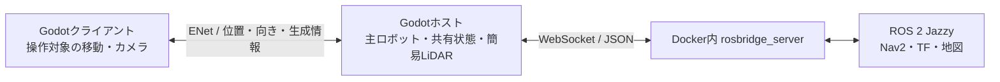

# Godotシミュレーター実装計画

作成日: 2026-10-16。操作・オンライン対応の初期実装を`simulator/`へ追加済み。指定のWindows版Godot 4.7.2で、画面付きの1ホスト＋3クライアントによる通信と、坂・段差・凹凸の走破を検証した。ROS接続以降は未実装。起動と操作は[シミュレーターのREADME](../simulator/README.md)を参照。

## 目的と確定した要件

- Godotで、操作とオンライン参加を備えた簡易ロボットシミュレーターを作る。
- 同じアプリからホストまたはクライアントとして起動できる。
- 初期版の接続範囲はLAN/VPN。
- ホストの操作対象は主ロボット1台に固定する。視点を切り替えても主ロボットを操作・シミュレートし、ホスト用の別アクターを生成しない。
- ROSとの接続はホストだけでよい。クライアントへのROSインストールは不要にする。
- クライアントは通行人・カラーコーン・他のロボットを操作できる。
- TPS視点、Google Mapsの3D表示に似た操作、真上表示を用意する。
- 高度な車体物理や正確なセンサー再現は行わない。障害物検出は簡易2D LiDARで代替する。
- **キャラクター同士の衝突・押し合いは実装しない。** すり抜けを許容する。
- ワールドには坂道・段差がある。キャラクターは高さに追従するが常に直立し、地面に合わせた傾き・転倒は再現しない。
- 将来、ワールドをLiDARから生成した3Dメッシュへ置き換える。手作業で地形を斜面へ置き換えず、そのメッシュ上の坂・小段差・凹凸を走破できる構成にする。
- 簡易LiDARは物体だけを検出する。床・坂道を除外し、段差・崖の走破可否のセンサー認識は後回し。
- 初期版の通行人・コーン・他のロボットは手動操作のみ。自動歩行・経路移動・歩行アニメーションは後回し。
- オンライン機能はホスト作成・IP指定で参加・途中参加まで。ホスト退出時は終了し、ホスト交代・以前の操作対象への復帰・配置保存は後回し。
- 操作とオンライン機能を実装・検証してから、ROSと接続する。

## 地形に関する採用方針

ユーザー回答を受け、地形の走破とセンサー検出を次のように分ける。

| 項目 | 方針 | 実装への影響 |
| --- | --- | --- |
| 地形・段差 | 取り込んだ3Dメッシュに接地し、小段差・凹凸を乗り越える | 共通の移動処理に段差乗り越えを含める。手作業の斜面配置には依存しない |
| 姿勢 | 高さに追従し、常に直立 | roll・pitchや車輪の接地姿勢は計算しない |
| LiDARの対象 | 壁・箱・キャラクターなどの物体。床・坂道は対象外 | 移動用の地形形状と、センサー用の検出形状を分ける |

初期の実行要件は、同じPCで1サーバー＋3クライアントの計4ウインドウ。指定されたWindows版Godot 4.7.2を使用し、WSL内のソースからWindows上での起動を検証した。ROSは既存のLinuxコンテナ側へ後から接続する。

## 推奨構成



- Godot 4.7.2とGDScriptを使う。描画はCompatibilityモード・影なしとし、主ロボットはCub4モデル、他のアクターと初期ワールドは単純な形状を使う。操作中45 FPS・非操作ウインドウ30 FPSを上限にする。
- 単独利用もホスト起動として扱う。専用のオフライン実装を作らない。
- 初期版のホストは画面付きでよい。画面なし起動は必要になった段階で追加できる構成にする。
- ワールドの更新とカメラを分離する。ホストは主ロボットを維持したままTPS・3D地図・2D地図を切り替える。

### 移動と同期

キャラクター同士が衝突しないため、各操作担当が自分のキャラクターを動かし、ホストへ3D位置と進行方向の角度（yaw）を送る。ホストは最新状態を保持して他の参加者へ配信する。地形の高さも送信位置に含めるため、受信側で接地や重力を再計算する必要はない。

| 対象 | 移動を計算するアプリ | 初期操作案 |
| --- | --- | --- |
| ROSに接続する主ロボット | 常にホスト | ホストの手動入力、またはROSの速度指令 |
| 通行人 | 操作している参加者 | カメラの水平向きを基準にしたWASD移動。高さは地形に追従 |
| カラーコーン | 操作している参加者 | 選択してWASDで移動し、地形に接地。操作を離すと静止 |
| 他のロボット | 操作している参加者 | 前後移動と旋回。初期版はROSに接続しない |

ホストが担当する主ロボットも共通の移動処理を使う。ホストはアクターの種類変更を行わず、主ロボットの操作と視点変更を行う。初期版では主ロボットの遠隔手動操作を省き、ホストが手動・ROSモードを選択する案とする。

- ホストがキャラクターID・種類・操作担当を管理する。1人が同時に操作する対象は1体。
- 初期版では参加時に選んだ種類を生成し、その参加者に割り当てる。既存キャラクターの取り合いや担当移譲は後回し。
- 配置や担当情報と、繰り返し送る3D位置・yawの更新を分ける。roll・pitchは常に0とし、同期しない。
- 操作対象はローカルですぐ動かす。遠隔キャラクターは操作担当のシミュレーション経過時刻が付いた位置履歴を約120 ms蓄え、描画時刻の前後の位置・yawを補間する。中継による重複更新は履歴に追加せず、まとめて届く更新で速度が変動するのを避ける。
- 遠隔キャラクターには移動・接地処理を実行しない。受信位置を使い、ホストでは同じ位置へセンサー用形状を配置する。
- 移動予測、巻き戻し、全端末の物理状態の一致は実装しない。
- 自分の操作対象以外の更新はホストが受け付けない。Godot上の複製管理の権限はホストに集約できる。
- クライアント切断時はその操作キャラクターを削除する。主ロボットは残す。

ネットワークにはGodot標準のENetを使う。初期実装は少数のRPCで生成・削除・種類変更・途中参加を管理し、移動状態はコンパクトな配列で共有する。`MultiplayerSpawner`・`MultiplayerSynchronizer`は使用していない。生成時にID・種類・担当・初期位置を配り、途中参加時にはホストが保持する現在位置を配る。

初期実装は位置更新20 Hz、移動・接地60 Hz、描画上限45/30 FPSとする。移動更新は最新値を優先し、生成・削除・担当情報は確実に送る。操作担当の経過時刻をホストが変更せず中継するため、端末間の時計同期は不要とする。再生速度はバッファ量が大きく変わったときだけ小幅に調整し、受信停止中は最後の位置で保持する。大きな位置変更では履歴を初期化し、長い停止からの復帰でも表示遅延が積み上がらないようにする。通信プロトコルは版2。[Godotのネットワーク機能](https://docs.godotengine.org/en/stable/tutorials/networking/high_level_multiplayer.html)

### 地形に沿う移動

共通の移動本体を`CharacterBody3D`にし、水平移動・旋回・簡単な重力と接地に、小段差の乗り越え処理を加える。地面の法線にモデルを合わせず、上方向は常にワールドの`+Y`とする。主ロボットも車輪の物理モデルを使わず、同じ接地処理で地形を移動する。

- キャラクターの当たり判定は単純なカプセル形状を第一候補とし、見た目のメッシュとは分ける。
- 通常は`move_and_slide()`で固定地形への衝突と斜面移動を扱う。
- `floor_snap_length`で下り坂への接地を助け、`floor_stop_on_slope`で停止時に滑り落ちる動作を省く。
- 斜面による速度変化も省く案として`floor_constant_speed`を使う。登れる最大傾斜と接地距離は調整可能にする。
- 地形は静的な三角形メッシュのコライダーとし、可動床や物体の押し合いは初期版に含めない。
- `move_and_slide()`だけで垂直な段差を自動で乗り越えられるとは扱わない。進行方向が地形に阻まれた際、上方・前方・下方への形状による移動テストで、設定した高さ以内の段差に乗れるかを確認する。
- 乗り越え先には歩行可能な支持面と胴体を置ける空間が必要。上方や前方の障害物を突き抜けず、条件を満たす場合だけ位置を更新する。
- 足元の複数レイを接地の補助に使い、スキャン由来の細かな凹凸で単一の三角形だけに反応する動作を抑える。外れ値の扱いと許容幅は試作地形で調整する。
- 上り段差で本体位置を変える場合も、モデルとカメラの高さ変化は表示側でなめらかにする。表示の補間位置を接地判定やセンサー計算には使わない。
- 最大段差高・最大傾斜・接地距離・凹凸の許容幅をパラメーターにする。現在の初期実装は最大段差高0.24 m、最大傾斜46度。実機の走破能力の再現値とは扱わない。
- ジャンプは初期案に含めない。設定範囲内の坂・段差・凹凸を、直立したまま連続して移動できることを確認する。

斜面・接地には[CharacterBody3D](https://docs.godotengine.org/en/stable/classes/class_characterbody3d.html)、位置を確定する前の移動テストには[PhysicsBody3D.test_move()](https://docs.godotengine.org/en/stable/classes/class_physicsbody3d.html#class-physicsbody3d-method-test-move)や[物理空間への問い合わせ](https://docs.godotengine.org/en/stable/classes/class_physicsdirectspacestate3d.html)を利用する。段差乗り越えの組み合わせは本プロジェクト側で実装する。地形への接地は操作担当のアプリだけで計算し、オンラインで衝突結果を照合する仕組みは作らない。

### 将来のLiDAR由来メッシュへの対応

- 手作りのテストワールドと、将来の取り込みメッシュを同じワールド構成で扱う。ワールド差し替えで移動コードを変更しない。
- 入力はGodotへ取り込める三角形メッシュとする。点群からメッシュを再構成する処理は、シミュレーター本体の初期実装には含めない。
- 取り込み時に表示用メッシュから移動用の静的コライダーを生成する。地形の凹凸を一つの凸形状で覆わず、`StaticBody3D`と`ConcavePolygonShape3D`による三角形メッシュを基本にする。[Godotのメッシュ衝突形状](https://docs.godotengine.org/en/stable/classes/class_concavepolygonshape3d.html)
- 必要に応じて取り込み時の軽量化を行い、その結果を保存する。毎フレームのメッシュ再生成や、手作業での斜面配置は前提にしない。
- スケール、上方向、原点、面の向きは取り込み時にそろえる。地面の欠損面を無制限に自動補修する処理は作らず、小さな凹凸は移動側の許容幅で扱う。
- 初期版では各アプリへ同じワールドを同梱し、将来の差し替え時にも同じマップID・版を使用する。メッシュのリアルタイム配信・同期は行わない。
- 実際のスキャンメッシュが未提供の間も、細かい三角形・不均一な凹凸・小段差を含むテストメッシュで移動を検証する。実データ導入時には、そのメッシュでパラメーターと処理時間を確認する。

### 衝突と障害物検出は分ける

キャラクター同士が接触して止まる処理を省いても、地形に接地する形状とLiDARから見える形状は必要になる。

- 移動本体は固定地形にだけ衝突し、キャラクター間の移動衝突を無効にする。
- 移動用地形・キャラクター本体・センサー用形状のレイヤーを分ける。センサー用形状は移動を妨げない。
- センサー専用の簡単な形状を用意する。人は円柱、コーンやロボットは円柱または箱でよい。
- LiDARの判定対象にセンサー用形状を含め、自分自身の形状を除外する。
- コーンがビームの高さより低い問題は、センサー用形状をその高さまで伸ばして簡略化する。
- 壁との移動衝突は固定地形への判定として残す案を推奨する。キャラクター間の衝突解決は不要。
- 床・坂道は移動用レイヤーに置き、LiDAR用レイヤーから除外する。壁・箱は両方の判定対象にする。
- 床と壁が一体になったスキャンメッシュは、オブジェクト全体をLiDARから除外しない。取り込み時にセンサー用形状を別生成し、面の向きによる簡易な地面抽出で上向きの床・坂を除き、壁などの立面を残す。
- 地面抽出は幾何形状による近似でよく、物体の意味分類や正確な段差・崖の認識は作らない。センサー用形状を取り込み時に保存し、毎スキャンの全三角形分類は避ける。

ホストは受信した最新のキャラクター位置にセンサー用形状を置き、その位置から測距する。クライアントの画面と検出位置に通信遅延分の差が出ることを許容する。遠隔表示の補間位置をセンサー計算に流用しない。

### カメラ

3種類を別々に実装せず、共通の`CameraRig`で追従対象・注視点・俯角・距離・投影方式を切り替える。

- TPS: 選択キャラクターを追従し、カーソルを捕捉してボタンを押さないマウス移動で周囲を見渡す。
- 3D地図: カーソルを表示し、左ドラッグで平行移動、Ctrl＋左ドラッグまたは中ドラッグで回転・傾きを変える。Google Mapsの地理データは使用しない。
- 真上の2D地図: 正投影で向きを固定し、左ドラッグで平行移動する。カーソルを動かすだけでは視点を変えない。
- 地図のホイールズームはカーソル位置を基準にし、ダブルクリックでも拡大する。3D／2Dの切り替えでは注視点を保つ。
- カメラの位置・角度はネットワーク同期しない。
- 注視点は操作対象の高さを基準にする。地図のドラッグ開始位置とズーム位置は静的地形へのレイで求め、地面が常に高さ0であるとは仮定しない。ドラッグ中は最初に選んだ地形の高さの平面を使い、メッシュの継ぎ目や段差での移動の飛びを避ける。

開始前はマウスで名前・接続先・クライアント用アクターを設定し、Host / Joinを選ぶ。ホストは選択値にかかわらず主ロボットで開始する。プレイ中はWASDで移動、ホイールでズーム、1 / 2 / 3で視点を切り替える。Tによるアクター変更はクライアントだけで有効にする。地図モードはIJKLでも平行移動できる。

Godotエディタの「実行インスタンスのカスタマイズ」では、各行の起動引数に`-- --host`または`-- --join ADDRESS`を指定して自動開始できる。`--actor`でクライアントの操作対象、`--name`・`--camera tps|3d|2d`で各ウインドウの名前・初期視点を決め、`--port`で共通のUDPポートを指定する。ホストのアクターは起動引数でも主ロボットに固定する。役割を省略した場合は開始前の画面で待ち、引数の誤りも同画面へ表示する。4インスタンス分の貼り付け例は[シミュレーターのREADME](../simulator/README.md#godotエディタから役割を指定して起動する)を参照。

プレイ中のUIは下部の高さ28pxの1行に絞り、座標・向き・役割・操作対象・カメラモード・キャラクター数・FPSを表示する。ボタンや操作説明は表示しない。TPSはEscでカーソルを解放し、Tabで視点操作へ戻す。地図モードはEscでドラッグを中断する。非アクティブ時とTPSでのカーソル解放中は移動・視点入力を止める。地図モードではカーソルを表示したままキャラクターを移動できる。Backspaceで退出し、接続失敗・ホスト切断時もマウス操作の開始前画面へ戻す。TPSのカメラは注視点からのレイで地形へのめり込みを避ける。

## ROSとの接続方法

**初期版は、ホストの`WebSocketPeer`からDocker内の`rosbridge_server`へ接続する方法を推奨する。**

| 方法 | 利点 | 追加の負担 | 判断 |
| --- | --- | --- | --- |
| rosbridge / WebSocket / JSON | 既存のROSトピックをそのまま送受信できる。GodotにROSの共有ライブラリを組み込まずに済む | JSON変換、TF・時刻・QoSの確認が必要 | 初期版の推奨 |
| 独自WebSocketサーバー＋rclpy | ROSメッセージ生成やTFをPythonにまとめられる | 独自プロトコル、接続管理、依存ライブラリを保守する | rosbridgeで具体的な制約が出た場合の候補 |
| ROS 2対応のGDExtension | Godotから直接ROS APIを呼べる | Godot・ROS・OSに応じたビルドと配布を確認する必要がある | 初期版では採用しない案 |

rosbridgeはJSONとWebSocketによるROS操作を提供し、Godotにも標準のWebSocketクライアントがある。今回の小容量な位置状態とLaserScanの送受信から試すのに適している。これは構成上の推奨であり、通信性能の実測結果ではない。[rosbridge公式README](https://github.com/RobotWebTools/rosbridge_suite/tree/ros2)、[GodotのWebSocket](https://docs.godotengine.org/en/stable/tutorials/networking/websocket.html)

直接ROSを組み込む拡張として[godot_ros](https://github.com/flynneva/godot_ros)なども存在するが、ROS実行環境への依存を伴う。初期版は接続境界を`RosBridgeClient`にまとめる。

### 最小のROS入出力

| 方向 | トピック・情報 | 初期方針 |
| --- | --- | --- |
| ROS → ホスト | `/cmd_vel` (`geometry_msgs/msg/Twist`) | 主ロボットの前進速度・旋回速度に適用 |
| ホスト → ROS | `/odom` (`nav_msgs/msg/Odometry`) | 高さを含む主ロボットの正解位置と実際の移動速度から生成。姿勢はyawのみ |
| ホスト → ROS | `/scan` (`sensor_msgs/msg/LaserScan`) | ホストだけで計算する簡易2D LiDAR |
| ホスト → ROS | `/tf` の `odom → base_link` | `/odom`と同じ姿勢・時刻を使う |
| ROS内 | `map → odom` | 初期版では恒等変換として1か所から配信 |
| ROS内 | `base_link`以下の固定TF | `robot_state_publisher`と既存URDFを使う |
| ROS内 | `/map` | Godotの固定テストマップと一致する占有地図を用意 |

- 最初は実時間のみ、ROSは`use_sim_time=false`とする案。`/clock`、一時停止、倍速、時刻の巻き戻しは後回しにできる。
- タイムスタンプはROSと同じ実時間にし、センサー測定時の位置と対応させる。
- 初期版は主ロボット1台だけをROSに接続する。複数ROSロボットの名前空間管理は後回し。
- `MANUAL` / `ROS` / `STOP`をホストで切り替える。同時に複数の操作源を適用しない。
- ROS切断・速度指令の一定時間未受信時は、ROSモードの主ロボットを停止する。復帰時は新しい指令を待つ。
- ROSの自己位置推定は最初は起動しない。正解位置を使ってNav2の経路計画と回避を確認する。
- 3D点群認識・実機の自己位置推定精度・タイヤの滑りの評価は、この構成では行わない。

### 簡易LiDAR

初期案は360度、360本、10 Hz。測距範囲はテストマップに合わせて固定する。

- 地面の傾斜に合わせてセンサーを傾けず、主ロボットの高さを基準に水平方向へレイを飛ばす。壁・箱・人・コーン・他のロボットの簡略形状までの距離を返す。
- 床・坂道は検出対象外とする。坂の先の物体がビームの高さから外れる場合の厳密な再現は初期版に求めない。
- 1回のスキャンは同じ時刻の瞬間測定として扱う。回転中の走査歪み、反射率、ノイズは省く。
- 非ヒット時のJSON表現を明示する。最初は有限の最大測距値を返す案とし、障害物として記録する最大距離をそれより短く設定して、空いた場所のクリアリングが動くことを確認する。
- センサー位置は`base_link`から固定オフセットとし、対応する固定TFを1か所から配信する。
- 運動計算には物理エンジンの車輪モデルを使わず、速度と旋回速度から水平移動を指示し、接地処理で高さを追従させる。

### 座標・QoS・地図の最低限の約束

GodotとROSは軸の取り方が異なるため、変換を1か所にまとめる。1 Godot単位を1 mとし、Godotの前方を`-Z`にした場合の位置変換は、初期原点が一致していれば`ROS(x, y, z) = Godot(-z, -x, y)`とする。向きと角速度も同じ基底変換に従わせ、前進・左旋回・地図原点を確認する。

採用するJazzy向けrosbridgeの実バージョンで、`/scan`・`/odom`・`/tf`のQoSが購読側と合うことを確認する。最新のプロトコル資料にある機能がインストール版で使えるとは仮定しない。固定TFはROS側で配信し、Godotから`/tf_static`を送る実装を省く。[rosbridgeプロトコルとQoS](https://github.com/RobotWebTools/rosbridge_suite/blob/ros2/ROSBRIDGE_PROTOCOL.md)

マップはまず固定の小さなテストコースを同梱する。Godot側の床・壁配置とROS側の占有地図は、原点・縮尺・壁位置を一致させる。通行人やコーンなどの可動物は静的地図に焼き込まない。

Godot上の地形は高さを持つが、初期版のNav2用占有地図は水平面へ投影した2D地図とする。地形の標高幅に合わせてcostmapの障害物高さフィルターを設定し、坂の上でもスキャンが使われることを確認する。移動処理の設定で走破できる斜面・段差は通路として地図に表現する。橋の上下や複数階など、同じ水平位置に別々の通路が重なる場所への対応は、初期案に含めず必要性を別途判断する。

## 既存プロジェクトとの接点

- `ros/cub_navigation/param/cub4_nav2.yaml`のcostmapは、すでに`/scan`と`LaserScan`を障害物入力に使っている。簡易2D LiDARの接続先として利用できる。
- `ros/cub_commander/src/cub_commander.cpp`は`/cmd_vel`を`Twist`で購読している。ただしシミュレーターは車体向けシリアル通信経路を通さず、Nav2の最終速度出力に接続する。
- `ros/cub_navigation/launch/nav2_navigation_launch.py`には速度平滑化やcollision monitorを含む構成がある。ROS接続時に実際の出力トピックと型を確認し、初期版では不要なノードを起動しない専用launchを作る。
- 主ロボットの外観には`ros/cub_description/urdf/cub4.urdf`の縮尺・原点・回転と、参照先のOBJ・MTLを反映したCub4モデルを使う。他機の外観は簡易モデルを維持する。Godot用のGLBは`simulator/tools/build_cub4_model.py`で事前生成し、1サーフェス・頂点色・LODで描画する。汎用のURDF取り込み機構は作らない。固定TFはROS連携時に既存URDFを使う。
- `ros/cub_description/launch/display.launch.py`はRVizも同時に起動するため、そのまま必須経路にせず、シミュレーションlaunchから`robot_state_publisher`を個別に起動する。
- Docker共通設定は`network_mode: host`。Linuxホスト上のGodotから同じホストのrosbridgeへ接続する構成を第一候補とする。
- 実機用の起動一式には機器ドライバーや自己位置推定が含まれるため、シミュレーター用launchとパラメーターを分ける。
- `support_tools/3dmap_converter/`にはPLY点群からPGM＋YAMLの占有地図を作る既存ツールがある。将来のスキャン地図の2D地図作成で流用を検討する。3Dの三角形メッシュ生成とは別の処理として扱う。

## 実装工程と完了条件

| 工程 | 実装するもの | 完了条件 |
| --- | --- | --- |
| 1. ローカル操作 | Godotプロジェクト、坂・小段差・凹凸を含むテストメッシュ、4種類の簡単な外観、直立したまま接地・段差乗り越えを行う移動、共通カメラの3モード | ROSなしで操作できる。上り下り・停止時にも傾かず、下りで不必要に浮かない。許容範囲の段差やメッシュの継ぎ目で引っかからず、上限を超える段差や壁は突き抜けない。手作業の斜面配置なしで成立し、キャラクター同士はすり抜ける |
| 2. 最小オンライン | ホスト・IP指定参加、キャラクター生成・削除、担当管理、3D位置・yaw同期、途中参加 | 同じ実行ファイルを2〜3個起動して、各自の操作対象が他の画面に反映される。坂の高さと途中参加時の現在位置も一致する |
| 3. 操作とオンラインの受け入れ | 別PC/LAN/VPNでの確認、遠隔表示の補間、切断処理、操作表示 | キャラクターの二重生成や二重操作がない。坂・小段差・凹凸でも遠隔キャラクターの接地処理を重複実行しない。ホストは主ロボット1台に固定され、視点切り替えで別アクターを生成しない。切断した参加者のキャラクターが残らず、カメラ操作が他の参加者に影響しない |
| 4. ROSの最小接続 | 専用ROSパッケージ、rosbridge接続、速度指令、odom、TF | コンテナ内のROS速度指令で主ロボットが移動し、高さを含めてRViz上の姿勢と一致する。切断・指令停止で止まる |
| 5. LiDARとNav2 | 簡易スキャン、地面を除いたセンサー用形状、固定占有地図、シミュレーション用Nav2設定 | 人やコーンを動かすとRVizのスキャンとcostmapが更新され、通過後に障害物が消える。床と壁が一体のメッシュでも床・坂は検出せず壁を検出する。坂の上でもキャラクターを検出でき、Nav2で目標へ走行・回避できる |

工程3の合格後にROSとの接続実装を開始する。工程1〜3では後から必要になる`pose`・`velocity command`・`scan`の境界だけ決め、ROS形式や通信処理は持ち込まない。

オンライン検証は同一PCの複数プロセスから始め、次に別PC、最後にVPNで行う。VPNではUDP疎通と操作感を確認する。広いマップや大量の参加者への最適化は初期版に含めない。

地形の受け入れ条件は、平地、上り坂、下り坂、小段差の上り下り、連続する凹凸、三角形の継ぎ目、越えてはいけない高さの段差、壁、頭上の障害物を含める。実スキャンメッシュへの差し替え時にも同じ条件を確認する。任意の地形を無条件に通過させず、最大段差高・最大傾斜と必要な空間で走破範囲を定める。

ROSコマンドとビルドはプロジェクトのルールどおり`./docker/run_in_container.sh ...`経由で実行する。計画段階ではコンテナ起動やビルドは不要。

## 想定する配置

```text
simulator/                         # Godot。ROSなしで実行・配布できる
  project.godot
  scenes/                         # ワールド、キャラクター、カメラ、UI
  scripts/                        # 移動、セッション、状態同期
  assets/cub4/                    # cub_description由来の主ロボットの表示モデル
  tools/build_cub4_model.py        # Cub4のGLBを再生成するツール
  ros/                            # 後半で追加するRosBridgeClient
  maps/                           # 同梱テストメッシュと将来の取り込みワールド
ros/cub_simulation/               # ROS連携段階で追加するlaunch・設定・占有地図
docs/godot_simulator_plan.md       # この計画
```

GodotはホストOS上で動かし、既存のROSコンテナを利用する。GodotとROSを同じコンテナに組み込む作業や、専用のオンラインバックエンドは初期版に含めない。

## 残る判断

初期実装はWindows版Godotで検証し、壁との移動衝突を残した。段差高・最大傾斜は現在24 cm・46度であり、実データ導入時に調整する。主ロボットの表示はCub4へ差し替え済みだが、移動用の当たり判定は従来の簡易カプセルを維持している。工程3の別PC・LAN/VPNでの検証は残っている。工程4の前に主ロボットの遠隔手動操作の要否、実時間のみでよいか、衝突形状・最高速度・旋回速度を決める。

最小構成を優先する場合の推奨は、差し替え可能なメッシュのワールド、直立したまま接地・小段差の乗り越えを行う共通移動、単純な外観、主ロボット1台、ホストだけが主ロボットを操作、実時間のみ、正解位置による自己位置、画面付きホストである。
